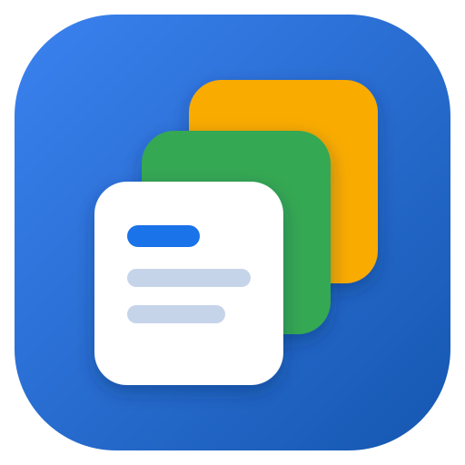
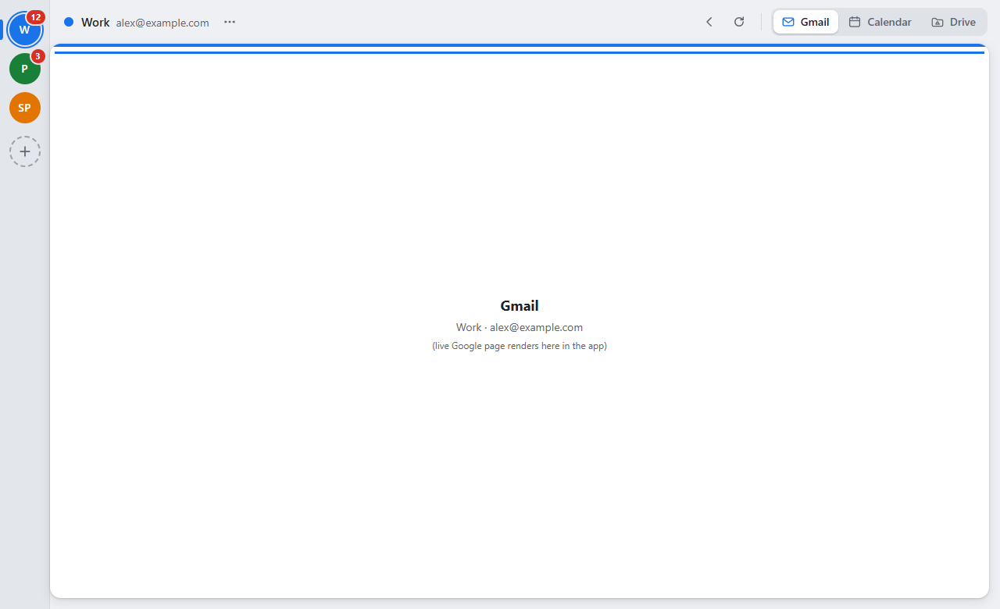

<div align="center">



# Swivel

**Gmail, Google Calendar and Google Drive for all your Google accounts, in one window.**

Switch accounts with one click or <kbd>Ctrl</kbd>+<kbd>1</kbd>…<kbd>9</kbd>. Sign in once and stay signed in.

[](https://github.com/coryhymel/swivel/actions/workflows/ci.yml)
[](https://github.com/coryhymel/swivel/releases/latest)
[](LICENSE)




</div>

## Why

If you juggle a work account, a personal account and a side project or two,
your browser ends up with a pile of Gmail and Calendar tabs and the
`/u/0`, `/u/1`, `/u/2` guessing game. Swivel gives each account its own isolated,
always-signed-in space and puts all of them one keystroke apart.

## Features

- **Every account side by side.** Add as many Google accounts as you like. Each one gets
  its own fully isolated session, so cookies are never shared between them.
- **Gmail, Calendar and Drive** for each account, a click (or <kbd>Alt</kbd>+<kbd>1</kbd>/<kbd>2</kbd>/<kbd>3</kbd>) apart.
- **Instant switching.** Pages stay loaded in the background, so going back to an inbox
  doesn't reload it.
- **Always know which account you're in.** Each account has a color shown on its
  avatar, the top bar and the edge of the page, plus its email address.
- **Unread badges** on each account's avatar, once its Gmail has been opened in that session.
- **Stays signed in** across restarts.
- **Links open in your browser.** Links in emails and calendar events, including Docs
  and Meet, open in your default browser. Compose and print windows stay in Swivel.
- **Private by design.** No accounts, servers, telemetry or analytics. Everything stays on your PC.
- **Updates itself** from GitHub Releases.

## Install

1. Download **`Swivel-Setup-x.y.z.exe`** from the [latest release](https://github.com/coryhymel/swivel/releases/latest).
2. Run it. It installs for your Windows user only, so no admin rights are needed.

> **"Windows protected your PC"?** Swivel's installer isn't code-signed yet, so
> Microsoft SmartScreen warns about it the first time. Click **More info → Run anyway**.
> If you'd rather not trust a binary, [build it yourself](#build-from-source):
> it only takes a couple of commands.

Swivel checks for updates on startup and every few hours. New versions download
in the background and install the next time you quit.

**Requirements:** Windows 10 or 11, 64-bit.

## Using Swivel

1. Click **+** in the left rail (or press <kbd>Ctrl</kbd>+<kbd>Shift</kbd>+<kbd>K</kbd>), give the account a name and a color.
2. Sign in to Google in the page that opens. You only do this once per account.
3. Repeat for your other accounts.

Right-click an avatar, or click **⋯** in the top bar, to rename, recolor or
remove an account. Removing an account also signs it out and deletes its saved data.

### Keyboard shortcuts

These work everywhere in Swivel, even while you're typing in Gmail.

| Shortcut | Action |
|---|---|
| <kbd>Ctrl</kbd>+<kbd>1</kbd> … <kbd>Ctrl</kbd>+<kbd>9</kbd> | Switch to account 1–9 |
| <kbd>Ctrl</kbd>+<kbd>Tab</kbd> / <kbd>Ctrl</kbd>+<kbd>Shift</kbd>+<kbd>Tab</kbd> | Next / previous account |
| <kbd>Alt</kbd>+<kbd>1</kbd> / <kbd>2</kbd> / <kbd>3</kbd> | Gmail / Calendar / Drive |
| <kbd>Ctrl</kbd>+<kbd>Shift</kbd>+<kbd>K</kbd> | Add an account |
| <kbd>F5</kbd> or <kbd>Ctrl</kbd>+<kbd>R</kbd> | Reload |
| <kbd>Alt</kbd>+<kbd>←</kbd> / <kbd>Alt</kbd>+<kbd>→</kbd> | Back / forward |

### Where links open

| From | Opens in |
|---|---|
| Gmail and Calendar | Your default browser, for every link (Docs and Meet included). Only compose, print and Google sign-in stay in Swivel. |
| Drive | Google pages (Docs, Sheets, Slides) open in a Swivel window signed in to the same account. Everything else goes to your browser. |

## Privacy & security

Swivel is a window around Google's own web apps. It doesn't have a backend, and
it never sees, stores or sends your mail anywhere except to Google.

- **Your data stays local.** Settings and sessions live in `%APPDATA%\Swivel`.
  Nothing is sent anywhere except to Google (and to GitHub to check for updates).
- **No telemetry, analytics or crash reporting.**
- **Encrypted cookies.** Session cookies are encrypted with Windows DPAPI, the
  same protection Chrome and Edge use.
- **Isolated accounts.** Each account has its own session partition. Google
  pages run sandboxed and can't reach Swivel's internals.
- **Locked-down permissions.** Camera and microphone are allowed only for Google
  Meet; notifications and the clipboard only for Google pages. Everything else
  is denied.

See [docs/ARCHITECTURE.md](docs/ARCHITECTURE.md#security-model) for the full
security model, and [SECURITY.md](SECURITY.md) to report a vulnerability.

## FAQ

<details>
<summary><b>Google says "This browser or app may not be secure"</b></summary>

Google blocks sign-in from some embedded browsers. Swivel presents itself as
Chrome to avoid this, and it normally works. If you see the message, wait a
few minutes and try again: repeated attempts in a short time make Google more
suspicious. If it keeps happening, please [open an issue](https://github.com/coryhymel/swivel/issues/new/choose).
</details>

<details>
<summary><b>How do I reset Swivel completely?</b></summary>

Quit Swivel and delete the `%APPDATA%\Swivel` folder. This removes every account
and signs them all out. Uninstalling Swivel leaves this folder alone, so
reinstalling keeps your accounts.
</details>

<details>
<summary><b>Does it work with Google Workspace accounts?</b></summary>

They should. Work and school accounts use the same Google sign-in, and Swivel
is built to let your organization's single sign-on page complete. If your
organization's sign-in doesn't work, please [open an issue](https://github.com/coryhymel/swivel/issues/new/choose).
</details>

<details>
<summary><b>Will there be a macOS or Linux version?</b></summary>

Swivel is built with Electron, so a port is mostly packaging work, but it's only
built and tested on Windows today. Contributions are welcome. See
[CONTRIBUTING.md](CONTRIBUTING.md).
</details>

<details>
<summary><b>Can I add other Google apps (Docs, Keep, Meet)?</b></summary>

Not yet. Services are defined in one list at the top of `main.js`, so it's a
reasonable first contribution. Please open an issue first to discuss it.
</details>

## Build from source

You need Windows, [Node.js](https://nodejs.org/) 20 or newer, and Git.

```
git clone https://github.com/coryhymel/swivel.git
cd swivel
npm install
npm start          # run from source
npm run dist       # build the installer into dist/
```

`npm run pack` builds just the unpacked app in `dist/win-unpacked/`, which is
quicker when you're testing packaging.

## Contributing

Bug reports, ideas and pull requests are welcome! Start with
[CONTRIBUTING.md](CONTRIBUTING.md). It covers setup, the project layout, how to
preview the UI in a plain browser, and the few rules that keep Swivel safe and small.

| Doc | What's in it |
|---|---|
| [CONTRIBUTING.md](CONTRIBUTING.md) | Dev setup, guidelines, pull requests |
| [docs/ARCHITECTURE.md](docs/ARCHITECTURE.md) | How Swivel works, the UI ↔ main-process API, security model |
| [docs/DESIGN.md](docs/DESIGN.md) | The UI design and the reasoning behind it |
| [docs/RELEASING.md](docs/RELEASING.md) | Cutting a release, auto-updates, code signing |
| [CHANGELOG.md](CHANGELOG.md) | What changed in each version |
| [SECURITY.md](SECURITY.md) | Reporting vulnerabilities |
| [CODE_OF_CONDUCT.md](CODE_OF_CONDUCT.md) | Community standards |

## License

[MIT](LICENSE) © 2026 Cory Hymel

---

<sub>Swivel is an independent open-source project. It is not affiliated with,
endorsed by or sponsored by Google LLC. Gmail, Google Calendar and Google Drive
are trademarks of Google LLC.</sub>
